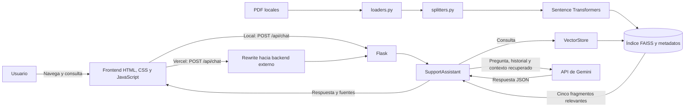

# Switch Care

Asistente conversacional de soporte para Nintendo Switch 2. Busca información en manuales PDF locales y, cuando hay una clave configurada, usa Gemini para responder con pasos y referencias al documento consultado.

**Estado:** prototipo académico funcional, en desarrollo.

**Autores del proyecto:** Julian Arley Ruiz Gonzalez y Luna Anahy Chaparro Bustos.

## Propósito

Los manuales de soporte contienen información repartida entre varios documentos y secciones. Switch Care permite consultar esa información en lenguaje natural, recuperar fragmentos relevantes y recibir una respuesta breve que conserva las referencias al manual. Está dirigido a usuarios de Nintendo Switch 2 que necesitan orientación basada en la documentación disponible, no a sustituir el soporte oficial ni a diagnosticar fallos fuera del corpus.

## Objetivos

### Objetivo general

Construir un asistente web que ayude a localizar y explicar instrucciones de los manuales de Nintendo Switch 2 mediante recuperación aumentada por generación (RAG).

### Objetivos específicos

- Procesar manuales PDF y dividir su texto en fragmentos con solapamiento.
- Recuperar fragmentos relevantes con embeddings multilingües, FAISS y coincidencia léxica tolerante a tildes.
- Generar respuestas en el idioma de la consulta, limitadas por la evidencia recuperada y con citas de fuente.
- Ofrecer una interfaz web con historial conversacional y consultas sugeridas.
- Mantener una interfaz de consola para probar el asistente sin navegador.

## Tecnologías

| Área | Tecnologías utilizadas |
|---|---|
| Interfaz | HTML, CSS y JavaScript; diseño adaptable sin framework de frontend |
| Backend y API | Python 3.13 en el entorno de desarrollo actual, Flask y Google Gen AI SDK |
| RAG y búsqueda | Sentence Transformers, `paraphrase-multilingual-MiniLM-L12-v2`, FAISS CPU y búsqueda léxica normalizada |
| Documentos | `pypdf` para extraer texto de PDF |
| Configuración | `python-dotenv` y variables de entorno |
| Evaluación | Ragas y un dataset local de 15 preguntas; el script de evaluación aún requiere actualización del modelo evaluador |
| Despliegue | Frontend estático y proxy en Vercel; backend Flask en un servicio Python externo |

Gemini se configura con `gemini-3.6-flash` como modelo principal y `gemini-3.5-flash` / `gemini-3.5-flash-lite` como respaldos predeterminados. Los nombres y la disponibilidad dependen de la API y de la cuenta utilizada.

## Arquitectura implementada

La aplicación sigue una arquitectura cliente-servidor modular. En local, Flask sirve el frontend y el endpoint de chat. En Vercel, el frontend se sirve como archivo estático y las consultas a `/api/*` se reescriben al backend Flask alojado en un servicio Python externo. El asistente coordina la recuperación y la generación; la carga de documentos, división de texto e índice vectorial están separados en módulos. La extracción, los embeddings y la búsqueda se ejecutan en el backend. Si se configura Gemini, solo se envían la pregunta, el historial recibido y los fragmentos recuperados, no el corpus completo.



El índice se persiste en `data/vector_db/`. Los fragmentos se generan con un tamaño de 300 palabras y un solapamiento de 50 palabras. La recuperación del asistente selecciona cinco fragmentos; el código de evaluación consulta tres.

## Funcionalidades

- Responder preguntas sobre los manuales PDF incluidos en `data/manuales/`.
- Tolerar tildes omitidas y algunas variaciones ortográficas al buscar términos.
- Entregar un resumen, diagnóstico, pasos, solución recomendada y nivel de confianza en JSON.
- Mostrar el nombre del documento y el índice del fragmento como fuente.
- Incluir el historial que envía la interfaz para interpretar preguntas de seguimiento.
- Usar modelos Gemini alternativos cuando una llamada o una salida estructurada falla.
- Funcionar sin clave de API en modo de demostración; en ese modo no genera una respuesta real del modelo.

El corpus actual contiene 10 manuales PDF europeos de Nintendo Switch 2, incluidos los documentos de cámara, adaptador de corriente, Joy-Con, dock y mandos.

## Estructura del proyecto

```text
.
├── data/
│   ├── eval_dataset.json
│   ├── manuales/                 # Manuales PDF incluidos
│   └── vector_db/                # Índice FAISS y metadatos persistidos
├── scripts/
│   └── evaluate_rag.py           # Evaluación Ragas en desarrollo
├── src/
│   ├── assistant.py              # Coordinación de recuperación y respuesta
│   ├── config.py                 # Rutas, clave y modelos Gemini
│   ├── loaders.py                # Extracción PDF/TXT
│   ├── prompt_templates.py       # Instrucciones y plantilla de consulta
│   ├── splitters.py              # División de texto
│   └── vector_store.py           # Embeddings, FAISS y recuperación
├── .env.example
├── index.html                    # Interfaz del chat
├── main.py                       # Ejecución en consola
├── web_app.py                    # Aplicación Flask y API
├── requirements.txt              # Sin dependencias para Vercel estático
├── requirements-backend.txt      # Dependencias del backend RAG
├── requirements-eval.txt         # Dependencias adicionales para evaluación
├── vercel.json                   # Rewrite de /api hacia el backend
├── .vercelignore                 # Excluye backend y corpus del despliegue Vercel
└── README.md
```

## Requisitos previos

- Python 3.13 (versión del entorno de desarrollo comprobado).
- `pip` y conexión a internet para instalar dependencias y descargar el modelo de embeddings en el primer uso.
- Una clave de Google Gemini para generar respuestas con un modelo remoto. Sin ella solo está disponible el modo de demostración.

## Instalación

Clona el repositorio y entra en la carpeta:

```bash
git clone https://github.com/Ruzkyy/Soporte_nintendo_proyecto.git
cd Soporte_nintendo_proyecto
```

Crea y activa un entorno virtual. En PowerShell:

```powershell
python -m venv .venv
.\.venv\Scripts\Activate.ps1
```

En Git Bash:

```bash
python -m venv .venv
source .venv/Scripts/activate
```

Instala las dependencias:

```bash
python -m pip install -r requirements-backend.txt
```

Para ejecutar la evaluación Ragas, instala también sus dependencias:

```bash
python -m pip install -r requirements-eval.txt
```

## Variables de entorno

Copia `.env.example` como `.env` y configura tu clave localmente. No publiques ese archivo ni compartas sus valores.

```env
GEMINI_API_KEY=
GEMINI_MODEL=
```

`GEMINI_API_KEY` es la variable recomendada. El código también reconoce `GOOGLE_API_KEY`. `GEMINI_MODEL` es opcional; si se omite, se usa `gemini-3.6-flash`. La disponibilidad de modelos puede cambiar y debe verificarse con la cuenta de Google utilizada.

Para Vercel, configura `RAG_BACKEND_URL` en las variables de entorno del proyecto. Debe ser el origen HTTPS del backend, sin `/api/chat` ni una barra final. La clave Gemini solo se configura en el servicio del backend, nunca en Vercel ni en el frontend.

## Ejecución

### Interfaz web

```bash
python web_app.py
```

Abre <http://127.0.0.1:5000>. El índice local se crea al iniciar por primera vez si todavía no existen los archivos persistidos. La descarga inicial del modelo de embeddings puede tardar.

### Consola

```bash
python main.py
```

Escribe una consulta en el prompt. Para salir, introduce `salir`, `exit` o `finalizar`.

## API

La aplicación ofrece una ruta para la interfaz y un endpoint JSON de chat:

| Método | Ruta | Descripción | Autenticación |
|---|---|---|---|
| `GET` | `/` | Sirve `index.html` | No |
| `POST` | `/api/chat` | Responde una consulta usando el historial opcional | No |

Ejemplo de petición:

```http
POST /api/chat
Content-Type: application/json
```

```json
{
  "question": "¿Cómo conecto la cámara?",
  "history": []
}
```

La respuesta incluye `resumen`, `diagnostico`, `pasos`, `solucion_recomendada`, `nivel_confianza` y `fuentes`. La aplicación no implementa autenticación; Flask se configura para escuchar en `127.0.0.1` y debe tratarse como un servidor de desarrollo local.

## Despliegue

El backend RAG importa PyTorch, Transformers, SciPy y FAISS, por lo que supera el límite estándar de 500 MB de Vercel Functions. Vercel aloja únicamente el frontend y reenvía las peticiones al backend, que debe ejecutarse en Render, Railway, Cloud Run u otro servicio Python con memoria suficiente.

En el servicio del backend:

- Instala `requirements-backend.txt`.
- Usa `gunicorn --bind 0.0.0.0:$PORT web_app:app` como comando de inicio.
- Configura `GEMINI_API_KEY`; el servicio debe proporcionar `PORT`.
- Conserva `data/manuales/` y `data/vector_db/` junto al código del backend.

En Vercel, importa el repositorio como proyecto estático, establece `RAG_BACKEND_URL` con el origen HTTPS del backend y vuelve a desplegar. `vercel.json` reescribe `POST /api/chat` al servicio externo; `.vercelignore` excluye del despliegue el entorno virtual, el código Python del RAG, los manuales y el índice. El endpoint no tiene autenticación, así que debe protegerse contra uso no autorizado antes de exponerlo públicamente.

Con el proyecto enlazado al CLI de Vercel, publica producción con:

```bash
vercel --prod
```

Esta configuración no implica que el backend externo ya esté desplegado ni que Vercel haya completado una publicación remota.

## Privacidad y seguridad

- Los manuales incluidos se leen y procesan localmente; el sistema no envía el corpus completo al modelo.
- Si hay una clave Gemini, se envían a la API la pregunta, el historial proporcionado y los fragmentos recuperados para generar la respuesta.
- Guarda las claves únicamente en `.env`. No incluyas secretos en el repositorio, capturas ni reportes.
- No uses el servidor de desarrollo de Flask como despliegue público ni para datos sensibles: esta versión no incluye autenticación.

## Evaluación y estado

El repositorio incluye `data/eval_dataset.json` con 15 preguntas y `scripts/evaluate_rag.py`, que propone medir `faithfulness`, `answer_relevancy`, `context_precision` y `context_recall` con Ragas. El script es experimental y contiene configuración de un modelo evaluador antiguo (`gemini-1.5-flash`); debe actualizarse y validarse antes de usarlo. No se publican métricas verificadas en este repositorio.

El chat y la recuperación local están implementados. Vercel está configurado como frontend/proxy, pero el despliegue requiere alojar el backend externo y definir `RAG_BACKEND_URL`. La evaluación cuantitativa y la autenticación siguen pendientes.

## Aprendizajes técnicos

- La recuperación combina similitud vectorial con coincidencia léxica normalizada para mejorar consultas en español con tildes omitidas o variaciones sencillas.
- Los fragmentos recuperados conservan metadatos de documento y posición para devolver fuentes visibles.
- La salida estructurada facilita la integración con la interfaz; las respuestas incompletas activan el siguiente modelo disponible.

## Autores

- Julian Arley Ruiz Gonzalez
- Luna Anahy Chaparro Bustos

